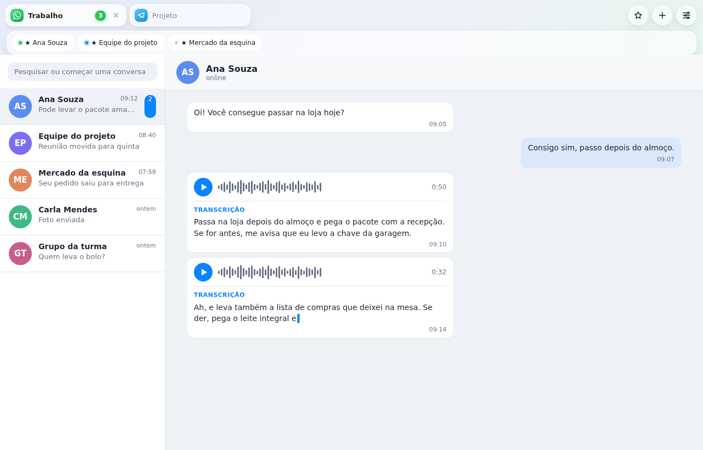
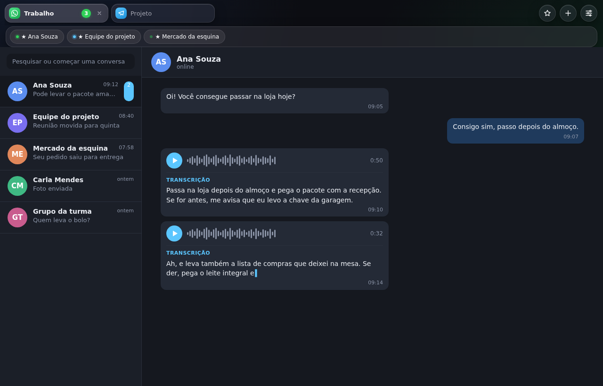
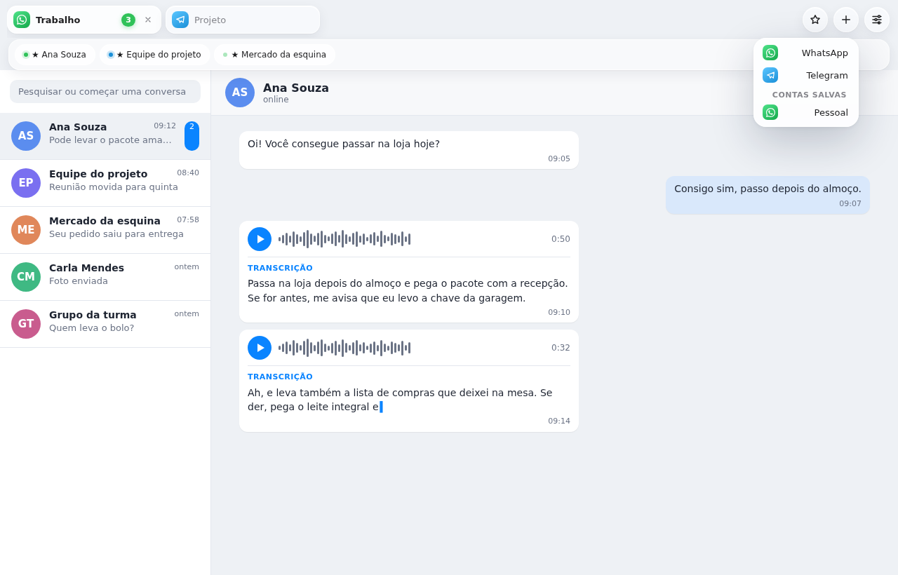
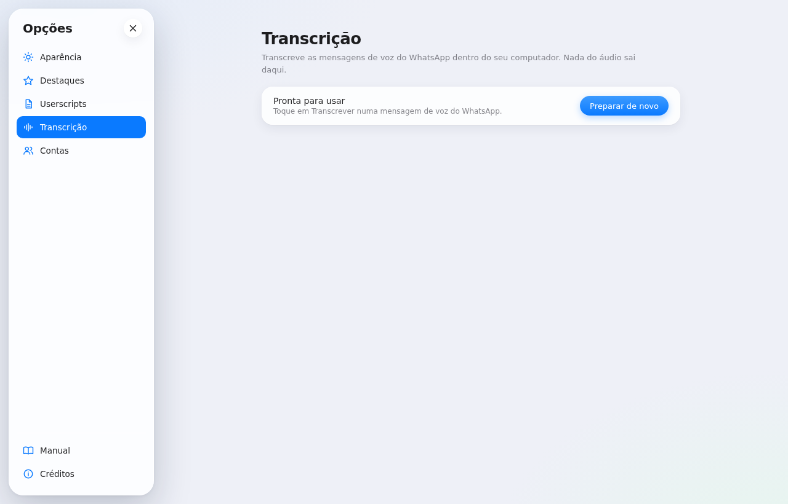
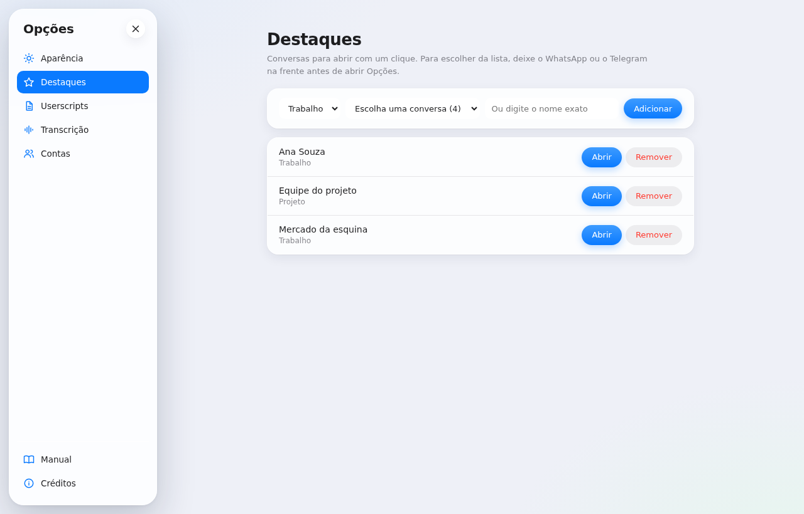
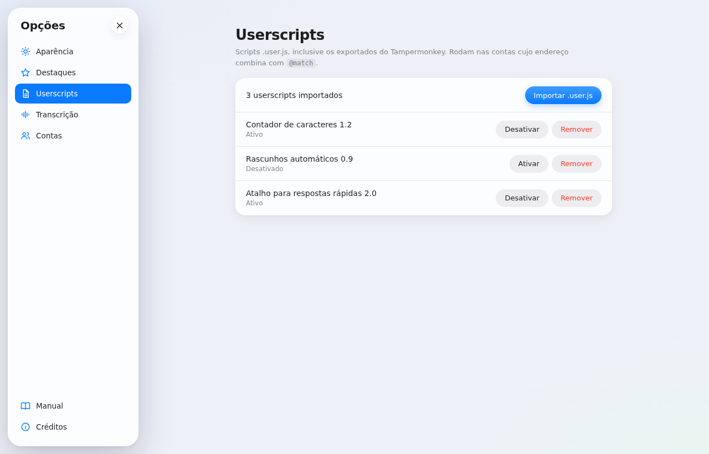
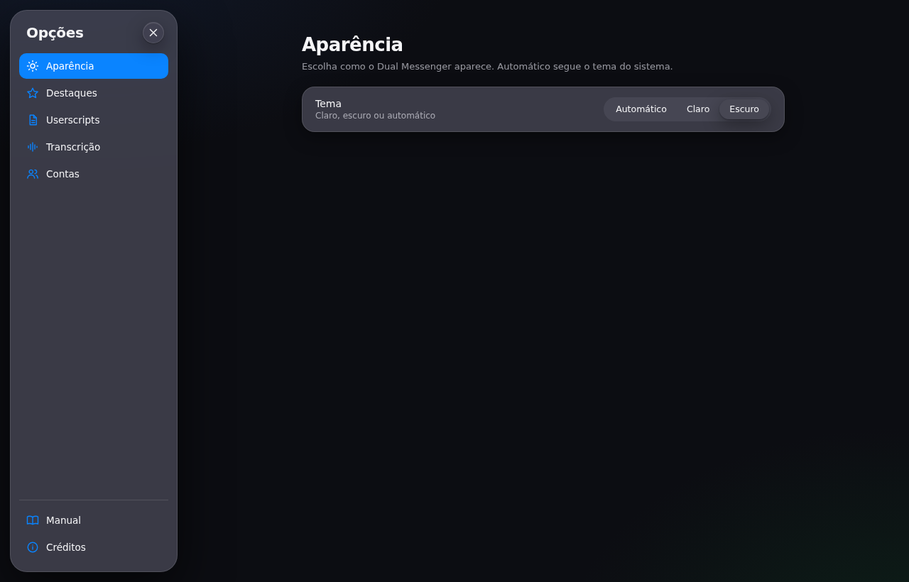
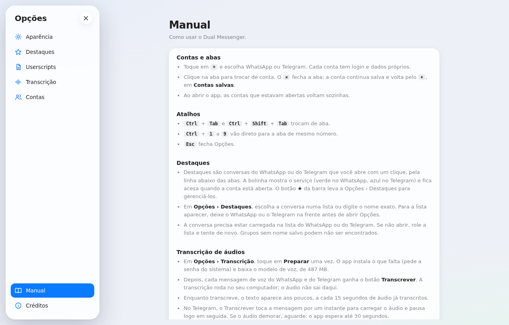

<p align="center">
  
</p>

<h1 align="center">Dual Messenger</h1>

<p align="center">
  <b>WhatsApp Web e Telegram Web em abas, cada conta com o seu login</b>, e transcrição das mensagens de voz no próprio computador.<br>
  Feito com Electron, para Linux.
</p>

<p align="center">
  
</p>

<p align="center">
  <i>Prints com dados fictícios. A interface é a do app; as conversas são ilustrativas.</i>
</p>

---

## O que é

O Dual Messenger abre várias contas de WhatsApp Web e Telegram Web numa janela só, em abas. Cada conta tem a sua sessão: o WhatsApp pessoal e o do trabalho convivem sem misturar login, histórico ou cache.

Este é um **projeto de estudo de UI/UX**. A interface foi desenhada e refeita para praticar design de interação: abas, faixa de destaques, estados da transcrição, configurações em painel lateral e temas.

Versão atual: **0.1.8** · [Releases](https://github.com/mpjsilva/DualMessenger/releases) · [Desenvolvimento](#para-desenvolvedores)

## Principais diferenciais

| | Navegador comum | Dual Messenger |
|---|---|---|
| **Contas** | Abas misturadas numa só sessão, ou perfis separados em janelas diferentes | Cada conta tem sessão própria, com nome e serviço visíveis na aba |
| **Destaques** | Favoritos genéricos | Conversas do WhatsApp e do Telegram numa faixa abaixo das abas. A bolinha mostra o serviço (verde no WhatsApp, azul no Telegram) e acende quando a conta está aberta |
| **Mensagens de voz** | Só tocar o áudio | Botão **Transcrever**: o texto aparece aos poucos, a cada 15 segundos de áudio, e tudo roda no computador |
| **Userscripts** | Extensão à parte, uma por navegador | Arquivos `.user.js` importados direto nas contas, com só as funções `GM_*` que cada script declara |
| **Teclado** | Atalhos fixos do navegador | Ctrl+Tab, Ctrl+1 a Ctrl+9 e Esc para trocar de aba e fechar as Opções |

E mais:
- **Tema claro, escuro ou automático**, em **Opções › Aparência**.
- **Manual no próprio app**, em **Opções › Manual**, e **Créditos** com as licenças de cada componente.
- **Ícone no menu de aplicativos**: ao abrir, o app grava o ícone e um atalho em `~/.local/share`.

## Telas

| | | |
|:-:|:-:|:-:|
| <br>Contas abertas e destaques | <br>Tema escuro | <br>Nova conta |
| <br>Opções › Transcrição | <br>Opções › Destaques | <br>Opções › Userscripts |
| <br>Opções › Aparência | <br>Manual no app | |

## Instalação

### Pelo AppImage (recomendado)

1. Baixe `DualMessenger-0.1.8.AppImage` na página de [Releases](https://github.com/mpjsilva/DualMessenger/releases) e confira o SHA-256 (está no arquivo `.sha256` ao lado).
2. Torne o arquivo executável e abra:

```bash
chmod +x DualMessenger-0.1.8.AppImage
./DualMessenger-0.1.8.AppImage
```

> Em distribuições recentes, o AppImage pede o FUSE 2 (pacote `fuse-libs` no Fedora, `libfuse2` no Debian e no Ubuntu). Sem ele, rode com `./DualMessenger-0.1.8.AppImage --appimage-extract-and-run`.

O AppImage não inclui o whisper.cpp, o modelo de voz nem o ffmpeg. O botão **Preparar**, descrito abaixo, instala o que falta (inclusive o ffmpeg), compila o whisper.cpp e baixa o modelo.

### Pelo código-fonte

Precisa de Node.js com npm.

```bash
git clone https://github.com/mpjsilva/DualMessenger.git
cd DualMessenger
npm install
npm start
```

## Transcrição de mensagens de voz

1. Em **Opções › Transcrição**, toque em **Preparar** uma vez. O app instala o que falta, compila o whisper.cpp e baixa o modelo Whisper small (487 MB), que transcreve em português. O código do whisper.cpp vem do GitHub e o modelo do Hugging Face.
2. Depois, cada mensagem de voz do WhatsApp e do Telegram ganha o botão **Transcrever**. O texto aparece aos poucos, a cada trecho de 15 segundos de áudio, e a versão final substitui o texto parcial.
3. O resultado fica guardado no computador (`transcricoes.json`, na pasta de dados do app). Transcrever o mesmo áudio de novo usa o texto guardado.

> **Requisitos:** o **Preparar** instala `git`, `cmake`, `g++` e `ffmpeg` com o `dnf`, pedindo a senha do sistema só se algum faltar. No Fedora, o `ffmpeg` vem do RPM Fusion: ative-o antes. Em outras distribuições, instale esses quatro programas antes do Preparar.

> **Velocidade:** a transcrição leva mais tempo que o áudio. Num dos computadores de teste, uma mensagem de 0:50 levou cerca de 31 segundos; o tempo depende da CPU.

## Controles principais

| Onde | Ação | O que faz |
|---|---|---|
| Janela | Ctrl + Tab / Ctrl + Shift + Tab | Próxima ou anterior aba (volta no fim) |
| Janela | Ctrl + 1 a Ctrl + 9 | Vai direto para a aba de mesmo número (a ordem é a da barra) |
| Janela | Ctrl + R | Recarrega a aba da frente |
| Barra | Arrastar uma aba | Reordena as abas; a metade onde você solta define antes ou depois |
| Destaques | Botão direito no destaque | Libera o destaque (a conversa não é afetada) |
| Destaques | Arrastar um destaque | Reordena os destaques |
| Barra | **+** | Nova conta: WhatsApp ou Telegram, ou uma conta salva |
| Barra | **★** | Abre Opções › Destaques |
| Barra | Ícone de ajustes | Abre Opções |
| Opções | Esc | Fecha Opções |
| Mensagem de voz | **Transcrever** | Transcreve no computador, em trechos de 15 segundos |

## Privacidade

- O WhatsApp e o Telegram são os sites oficiais, carregados dentro do app. O código não tem telemetria nem servidor do projeto.
- Cada conta usa uma partição própria do navegador embutido: cookies, cache e armazenamento não se misturam entre contas.
- A transcrição roda no seu computador. O áudio é gravado numa pasta temporária, usado e apagado no fim.
- Além do uso normal de WhatsApp e Telegram e dos scripts que você instalar, o único download do app é o do whisper.cpp e do modelo, no **Preparar**.

## Para desenvolvedores

- `src/main.js`: janela, abas, uma partição por conta e IPC.
- `src/motor.js`, `src/userscripts.js`, `src/gm-ipc.js`: userscripts e a API `GM_*`, sempre com token e permissão de `@grant`.
- `src/transcricao*.js`, `src/pagina-whatsapp.js`, `src/pagina-telegram.js`, `src/preload-transcricao.js`: transcrição local.
- `src/atalhos.js`: atalhos de teclado das abas.
- `src/store.js`: JSON com escrita atômica.
- `ui/`: barra de abas e Opções, em HTML, CSS e JavaScript puros.
- `docs/prints/`: as imagens deste README.

```bash
npm install
npm start          # abre o app
npm test           # testes unitários
npm run dist       # gera o AppImage em dist/
```

Diagnóstico: `DM_DEVTOOLS=1 npm start` abre o DevTools de cada conta, para inspecionar o HTML das mensagens.

Testes com o Electron real (não rodam no `npm test`):

```bash
npx electron tests/smoke-gm.js --no-sandbox --ozone-platform=headless --disable-gpu
WHISPER_BIN=... MODELO=... AUDIO=... node tests/smoke-transcricao.js   # WAV 16 kHz mono
```

## Limitações conhecidas

- A transcrição usa módulos internos do WhatsApp Web. Quando o WhatsApp mudar a estrutura, o botão pode parar de funcionar; o ajuste fica em `src/pagina-whatsapp.js`.
- No Telegram, o Transcrever toca a mensagem por um instante para carregar o áudio (e pausa logo depois). Se o áudio demorar, o app espera até 30 segundos. Os seletores seguem o Telegram Web A e podem mudar com as atualizações dele.
- Os destaques dependem da lista de conversas de cada site, lida pelos seletores de `src/conversas.js`. Grupos e conversas fora da lista carregada podem não ser encontrados.
- O instalador do **Preparar** conhece só o `dnf`. Em outras distribuições, a instalação das ferramentas é manual.
- O ícone no GNOME (dock, Alt+Tab, Atividades) não foi testado numa área de trabalho real.

## Agradecimentos

O Dual Messenger só existe porque outros projetos livres fazem o trabalho pesado por baixo:

**Base do app**
- **[Electron](https://www.electronjs.org)**: a janela e o navegador embutido de cada conta (licença MIT).
- **[electron-builder](https://www.electron.build)**: gera o AppImage.

**Transcrição**
- **[whisper.cpp](https://github.com/ggml-org/whisper.cpp)**, de ggml-org (licença MIT): a transcrição no computador.
- **Whisper**, da [OpenAI](https://openai.com), o modelo de voz usado pelo whisper.cpp, baixado do [Hugging Face](https://huggingface.co/ggerganov/whisper.cpp) no **Preparar**.
- **[FFmpeg](https://ffmpeg.org)** (LGPL ou GPL, conforme a build): converte os áudios para a transcrição.

**Userscripts**
- Os scripts usam o cabeçalho `==UserScript==` do [Tampermonkey](https://www.tampermonkey.net), extensão que popularizou o formato.

**Aviso:** WhatsApp e Telegram são marcas dos seus donos. Este projeto não é afiliado a nenhum dos dois.

## Licença

O código do Dual Messenger é distribuído sob a [GNU GPL v3.0](LICENSE). Os componentes de terceiros mantêm as licenças deles (veja os agradecimentos acima).

Feito por [mpjsilva](https://github.com/mpjsilva), com a ajuda do Claude (Anthropic) no desenvolvimento.
